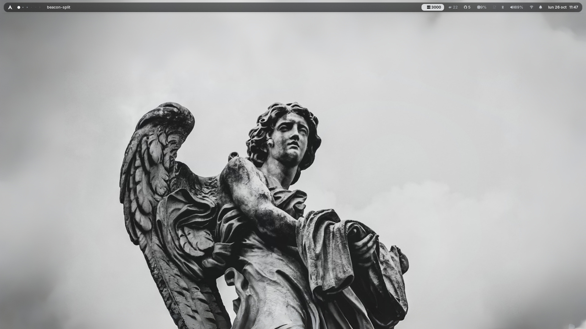
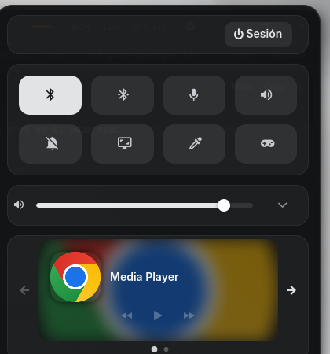

# 🌫️ Dotfiles

Mi configuración de **Arch Linux + Hyprland**, con un tema propio llamado **Niebla**: oscuro, minimalista y monocromo, con cristal esmerilado al estilo de macOS.



## Paleta Niebla

Grises fríos sacados de la niebla del wallpaper. El único color es un rojo apagado, que solo aparece para avisar.

| Color | Hex | Uso |
|---|---|---|
|  | `#141516` | Fondo |
|  | `#1a1b1d` | Superficie |
|  | `#e4e6e7` | Texto |
|  | `#c8ccd0` | Plata |
|  | `#8a8f93` | Niebla (texto secundario) |
|  | `#8b98a6` | Acero (acento) |
|  | `#b8656a` | Rojo apagado (solo avisos) |

**Cristal:** paneles `rgba(20,21,22,0.4–0.55)` con borde `rgba(255,255,255,0.09)` y el blur de Hyprland por debajo. **Tipografía:** [Inter](https://rsms.me/inter/) para la interfaz y JetBrainsMono Nerd Font para terminal e iconos.

## Componentes

| Qué | Cuál | Carpeta | Destino |
|---|---|---|---|
| Distro | Arch Linux | — | — |
| Compositor | [Hyprland](https://hyprland.org) + hypridle, hyprlock, hyprpaper | [`hypr/`](hypr) | `~/.config/hypr/` |
| Barra | [Waybar](https://github.com/Alexays/Waybar) | [`waybar/`](waybar) | `~/.config/waybar/` |
| Lanzador | [Wofi](https://hg.sr.ht/~scoopta/wofi), estilo Spotlight | [`wofi/`](wofi) | `~/.config/wofi/` |
| Centro de control y notificaciones | [SwayNC](https://github.com/ErikReider/SwayNotificationCenter) | [`swaync/`](swaync) | `~/.config/swaync/` |
| Terminal | [kitty](https://sw.kovidgoyal.net/kitty/) | [`kitty/`](kitty) | `~/.config/kitty/` |
| Shell | zsh + Oh My Zsh + [Powerlevel10k](https://github.com/romkatv/powerlevel10k) (una línea, solo a la izquierda) | [`zsh/`](zsh) | `~/.zshrc`, `~/.p10k.zsh` |
| Apps GTK | [adw-gtk3](https://github.com/lassekongo83/adw-gtk3) + paleta Niebla (GTK3 y libadwaita) | [`gtk/`](gtk) | `~/.config/gtk-3.0/`, `gtk-4.0/`, `gtk-niebla/` |
| Correo | [Thunderbird](https://www.thunderbird.net), tema "Niebla Mail" | [`thunderbird/`](thunderbird) | `<perfil>/chrome/`, `<perfil>/user.js` |
| Login | SDDM + [SilentSDDM](https://github.com/uiriansan/SilentSDDM) | [`sddm/`](sddm) | `/usr/share/sddm/themes/silent/configs/` |
| Scratchpads | [pyprland](https://github.com/hyprland-community/pyprland) | [`pypr/`](pypr) | `~/.config/pypr/` |
| Editor | [Zed](https://zed.dev), tema Niebla propio | [`zed/`](zed) | `~/.config/zed/` |
| Monitor | [btop](https://github.com/aristocratos/btop), tema Niebla propio | [`btop/`](btop) | `~/.config/btop/` |
| PDF | [Zathura](https://pwmt.org/projects/zathura/) | [`zathura/`](zathura) | `~/.config/zathura/` |
| Markdown | [glow](https://github.com/charmbracelet/glow), tema Niebla propio | [`glow/`](glow) | `~/.config/glow/` |
| Fetch | [fastfetch](https://github.com/fastfetch-cli/fastfetch) | [`fastfetch/`](fastfetch) | `~/.config/fastfetch/` |
| Herramientas | scripts propios (ver abajo) | [`bin/`](bin), [`systemd/`](systemd) | `~/.local/bin/`, `~/.config/systemd/user/` |
| Wallpaper | [`wallpapers/`](wallpapers) | [`wallpapers/`](wallpapers) | `~/.config/wallpapers/` |

## Lo que tiene

### Escritorio
- **Una sola barra de cristal**, como la barra de menús de macOS. A la izquierda, el logo (lanzador), los escritorios y la app activa; en el centro, la música; a la derecha, el estado y la hora. Pulsando la hora se abre el centro de control.
- **Módulos para programar** que solo aparecen si hay algo: servidor dev en marcha, contenedores Docker, notificaciones de GitHub y actualizaciones pendientes. Las stats (CPU, RAM, temperatura y disco) van plegadas y se despliegan al pasar el ratón.
- **Un escritorio por tipo de app.** El 1 es para terminales (y [Beacon Split](https://github.com/hxst1/Beacon-Split)), el 2 para el navegador, el 3 para el correo y el 4 para todo lo demás. Los paneles flotantes y los diálogos se abren donde estés.
- **Ventanas squircle** (`rounding_power`), blur con vibrancy, sombras suaves y animaciones con curvas tipo iOS.

### Centro de control



Botones rápidos para Bluetooth, vincular dispositivos ([bluetui](https://github.com/pythops/bluetui)), micrófono, mezclador ([wiremix](https://github.com/tsowell/wiremix)), no molestar, captura de pantalla, cuentagotas y modo gaming. También tiene volumen por app, el reproductor y un menú de sesión. Bluetooth, audio y Docker ([lazydocker](https://github.com/jesseduffield/lazydocker)) se abren como paneles TUI flotantes de cristal (`hypr/scripts/panel.sh`).

### Modo presencia ☕
Hay una taza en la barra. Con un clic quedas **siempre activo** en Slack, Teams y compañía. Cada 4 minutos se mueve el ratón 1 px con `ydotool` (un evento real, vía uinput) y el cursor vuelve a su sitio. Mientras está activo, se detiene `hypridle`, así que no hay bloqueo ni se apaga la pantalla. `waybar/scripts/presencia.sh`.

### Portapapeles iPhone → Arch 📋
`bin/iphone-clip` es un servidor mínimo, solo para la red local. Un Atajo de iOS (doble toque en la parte trasera) envía lo copiado en el iPhone, sea texto o imagen, y el servidor lo deja en el portapapeles de Hyprland con una notificación. Nunca pega nada por su cuenta. `GET /clip` sirve para la dirección contraria.
- **Seguridad:** token en la cabecera `X-Clip-Token`, solo IPs privadas y lista de permitidas opcional.
- **Fotos:** las HEIC se convierten a PNG.
- **Red:** el móvil encuentra el PC por mDNS (`arch.local`). Avahi está limitado a la interfaz de red con `allow-interfaces=`.

### Correo con Claude ✉️
`bin/correo-mcp` es un servidor [MCP](https://modelcontextprotocol.io) para Claude Code. Con él, Claude puede **leer** el correo y **crear borradores**, pero **nunca envía**: el borrador va a la carpeta Borradores por IMAP y lo revisas y envías tú desde Thunderbird.
- **Cuentas:** en `~/.config/correo-mcp/cuentas.toml`; tienes una plantilla en [`correo-mcp/cuentas.example.toml`](correo-mcp/cuentas.example.toml).
- **Contraseñas:** en el llavero del sistema, nunca en archivos. Se guardan con `correo-mcp-clave <dirección>`.
- **Registro en Claude Code:** `claude mcp add -s user correo -- ~/.local/bin/correo-mcp`.

### Prompt
Powerlevel10k en una sola línea, sin fondos: carpeta con icono, rama de git con estado (`⇡⇣ +staged !modificados ?nuevos ✘conflictos`) y `❯`, que se vuelve rojo si el último comando falló.

## Instalación

```bash
git clone git@github.com:hxst1/Dotfiles.git
cd Dotfiles

# Configs de usuario
cp -r hypr kitty waybar wofi swaync fastfetch btop zathura pypr glow zed ~/.config/
cp -r gtk/gtk-3.0 gtk/gtk-4.0 gtk/gtk-niebla ~/.config/
cp zsh/.zshrc zsh/.p10k.zsh ~/
mkdir -p ~/.config/wallpapers && cp wallpapers/* ~/.config/wallpapers/
cp bin/* ~/.local/bin/ && cp systemd/user/* ~/.config/systemd/user/

# Thunderbird: en tu perfil (~/.thunderbird/*.default-release/)
cp -r thunderbird/chrome <perfil>/ && cat thunderbird/user.js >> <perfil>/user.js
```

**Paquetes** (pacman/yay): `hyprland hypridle hyprlock hyprpaper waybar wofi swaync kitty pyprland inter-font ttf-jetbrains-mono-nerd adw-gtk-theme papirus-icon-theme papirus-folders bibata-cursor-theme ydotool bluetui wiremix lazydocker qrencode avahi wl-clipboard cliphist wl-clip-persist grim slurp swappy hyprpicker thunderbird sddm sddm-silent-theme`.

```bash
gsettings set org.gnome.desktop.interface gtk-theme 'adw-gtk3-dark'
gsettings set org.gnome.desktop.interface color-scheme 'prefer-dark'
papirus-folders -C grey --theme Papirus-Dark
systemctl --user enable --now ydotool             # modo presencia
systemctl --user enable --now iphone-clip         # portapapeles iPhone (crea antes el token en ~/.config/iphone-clip/token)
```

> ⚠️ Las configs asumen rutas de mi máquina (`/home/eya`, el monitor `DP-1`) en algunos sitios. Revísalas antes de usarlas.

Extras que usa el `.zshrc`: `eza`, `bat`, `zoxide`, `fnm`, `fzf`, `fd`, `lazygit`, `direnv` y los plugins `zsh-autosuggestions` / `zsh-syntax-highlighting`.

## Créditos

- **Wallpaper:** ángel de mármol del Ponte Sant'Angelo (Roma), [wallhaven 5y3pd8](https://wallhaven.cc/w/5y3pd8).

## Legacy

- [`legacy/sakura/`](legacy/sakura): el tema anterior, **Sakura** (lila, dorado y rosa), con sus temas de Zed, btop y glow, el wallpaper, capturas y el módulo [runcat-text](https://github.com/bzglve/runcat-text) de **bzglve** para la barra. El resto de configs de esa época está en el historial de git.
- [`legacy/alacritty/`](legacy/alacritty): mi antigua config de **Alacritty** (época macOS). **Desactualizada**, la conservo solo como archivo histórico. Ahora uso kitty.
